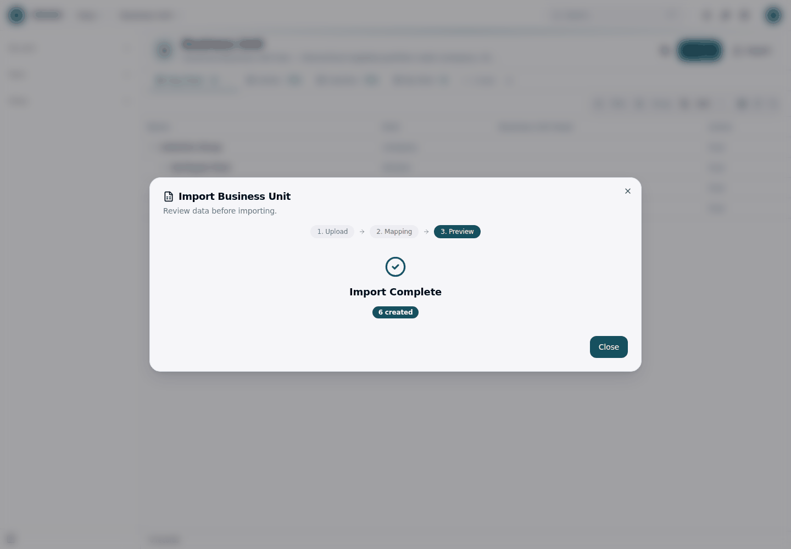
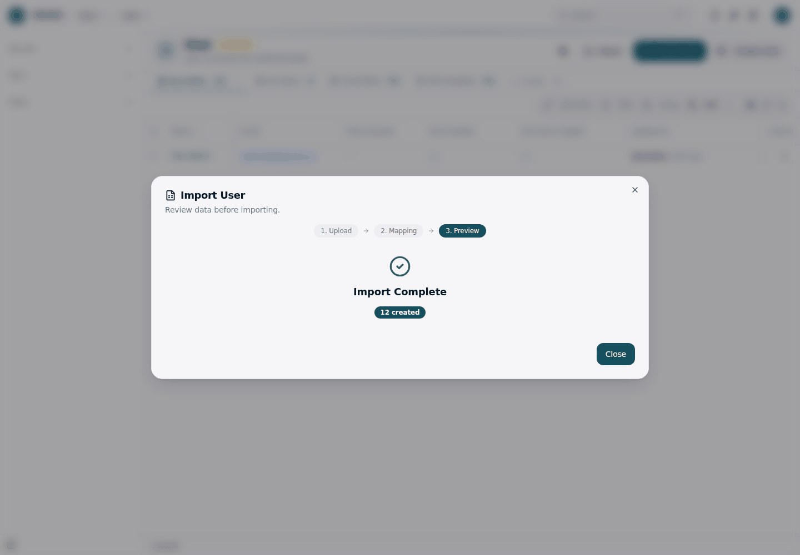
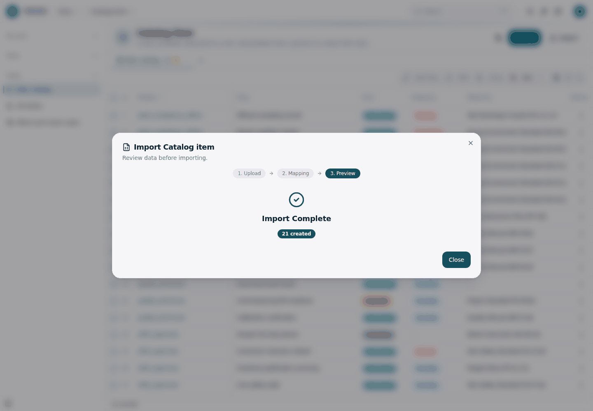
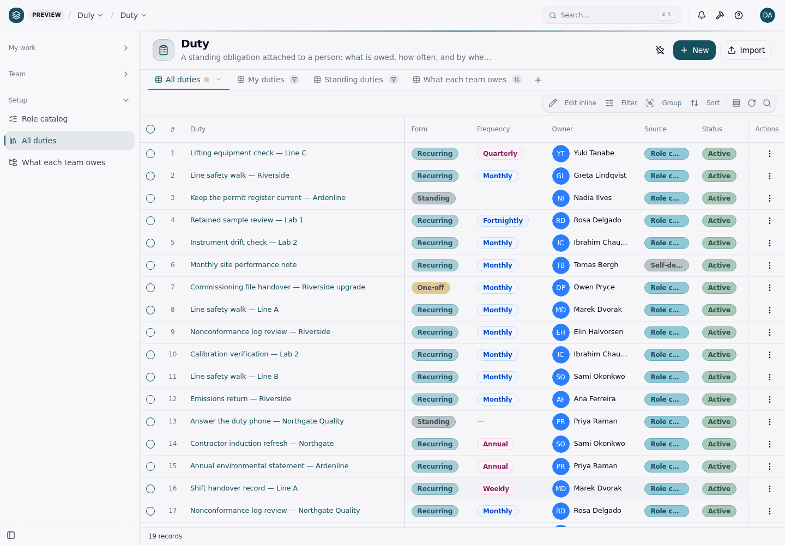

# Getting started — your own list, in about ten minutes

From an empty install to your people's duties in Duly, using the CSVs in
[`samples/`](../samples) as the stand-in for your own spreadsheet. Swap in your
own files at steps 2–5 and the path is the same.

Every step has the click, and the command where there is one. The screenshots
are from the [recorded import walk](import/walkthrough.md), which has the
detail behind each screen. What each step answered when it was last measured
is in the [template-readiness checklist](template-checklist.md#7--the-ten-minute-path).

> **Two steps do not finish today**, and the reason is the platform, not your
> data: the dispatcher has no run-now (step 7), and an imported duty is not yet
> visible to the person it names (step 8). Both are described where you will
> hit them.

## 1 · Install and sign in

```bash
git clone https://github.com/objectstack-ai/duly.git my-duties && cd my-duties
pnpm install
pnpm dev
```

Open `http://localhost:3000/_console/` and sign in as `admin@objectos.ai` /
`admin123`. The app is empty: one user (you), no units, no duties.

## 2 · Business units

**Setup → People & Organization → Business Units → Import**, upload
`samples/business-units.csv`, accept the mapping, import. 6 created.



A parent unit is written as its **name** and resolves within the same file, so
list parents above their children.

## 3 · People

**Setup → People & Organization → Users → Import**, upload `samples/people.csv`.
12 created.



Each person gets a real account and an invitation to set a password. On
`pnpm dev` nothing leaves the machine: the invitations land in the dev outbox,
the `sys_email` object, which you will read in step 8.

## 4 · Role catalog

**Duly → Setup → Role catalog → Import**, upload `samples/catalog-items.csv`.
21 created. This is the list itself: what each position owes, how often, with
how much grace. It has no lookups, so it imports into an empty app as it is.



## 5 · Duties

**Duly → Setup → All duties → Import**, upload `samples/duties.csv`. 19
created. This is the catalog put onto named people, so `owner`,
`business_unit` and `catalog_item` are written as **names** and must already
exist; that is why steps 2–4 come first.



Every imported duty starts **To confirm**, except a self-declared one
(`source = self`), which starts **To review**. Nothing dispatches yet: only an
approved duty produces tasks.

## 6 · Confirm and approve one duty

Open a weekly duty, for example *Shift handover record — Line A*, in **All
duties**. The record page shows the review pipeline; click **To review**, then
**Approved**.

You can approve it because it is somebody else's duty. *Approved* and
*Returned* are hidden from a duty's own owner, and the server refuses them from
the owner too: a review you issue on your own list is not a review.

The same two writes as commands, signed in as the admin:

```bash
O=http://localhost:3000
curl -s -c /tmp/duly.cookies -H "origin: $O" -H 'content-type: application/json' \
  -d '{"email":"admin@objectos.ai","password":"admin123"}' "$O/api/v1/auth/sign-in/email" > /dev/null
ID=$(curl -s -b /tmp/duly.cookies -H "origin: $O" \
  "$O/api/v1/data/duly_duty?top=100" \
  | node -pe 'JSON.parse(require("fs").readFileSync(0)).records.find(d => d.name === "Shift handover record — Line A").id')
for step in to_review approved; do
  curl -s -b /tmp/duly.cookies -H "origin: $O" -H 'content-type: application/json' -X PATCH \
    -d "{\"review_status\":\"$step\"}" -o /dev/null -w "$step %{http_code}\n" "$O/api/v1/data/duly_duty/$ID"
done
```

## 7 · Dispatch

The dispatcher is the job `duly_dispatch`. It runs **every night at 01:00 UTC**
and turns each approved, active, recurring duty into the tasks its period
owes, in the duty's own timezone. Re-running it changes nothing; that is what
the `(duty, owner, period_key)` index is for. `pnpm dev` switches the
platform's scheduled work on for you, but a deployment started with
`pnpm start` must set `OS_AUTOMATION_SCHEDULED_WORK_ENABLED=true`, or no duty
is ever dispatched and no reminder is ever sent.

> **There is no run-now today.** `@objectstack/*` 18.1.0 offers no CLI command,
> REST route or Console button that runs a job on demand (the job service has
> no HTTP surface, and the `sys_job` catalogue is read-only), so on a fresh
> install the first tasks appear after the next 01:00 UTC run, with `pnpm dev`
> left running. Until the platform gives jobs a run-now, `pnpm demo` is the way
> to see a populated week straight away: its history is planned by the same
> dispatcher code at build time.

## 8 · Open My week, as the owner

My week is each person's own list, so open it as the person the duty names.

1. **Give them Duly.** An invited person has an account but no Duly
   permission set, and every Duly object answers them `403
   PERMISSION_DENIED`. Assign **Duly — team member** (`duly_member`) to them;
   managers get **Duly — manager**, and Duly administrators **Duly —
   administrator**.
2. **Accept the invitation.** Read it from the dev outbox:

   ```bash
   curl -s -b /tmp/duly.cookies -H "origin: $O" "$O/api/v1/data/sys_email?top=50" \
     | node -e 'for (const m of JSON.parse(require("fs").readFileSync(0)).records)
                 console.log(m.to_addresses, (m.body_text.match(/https?:\/\/\S+/) || [""])[0])'
   ```

   Open the link for the duty's owner and set a password. The email is worded
   as a password reset; it is the invitation. The link expires after 60
   minutes.
3. **Sign in as them** and open **Duly → My work → My week**.

> **Today the imported duty does not show up for its owner.** The member set
> reads `own` rows, and the platform decides "own" from the record's platform
> owner, which for an import is the administrator who ran it, not the person
> in the duty's `owner` field. A duty the person creates themselves does show.
> Measured on 17.3.0; see the
> [checklist](template-checklist.md#7--the-ten-minute-path).

## Where to go next

- Replace the samples with your own spreadsheet: the
  [import walk](import/walkthrough.md) explains every column rule, and what a
  refused row looks like.
- See the finished picture: `rm -rf .objectstack/data && pnpm demo` (or
  `pnpm demo:zh`).
- Read [what makes it different](../README.md#what-makes-it-different) before
  you change a rule; most of them are load-bearing.
